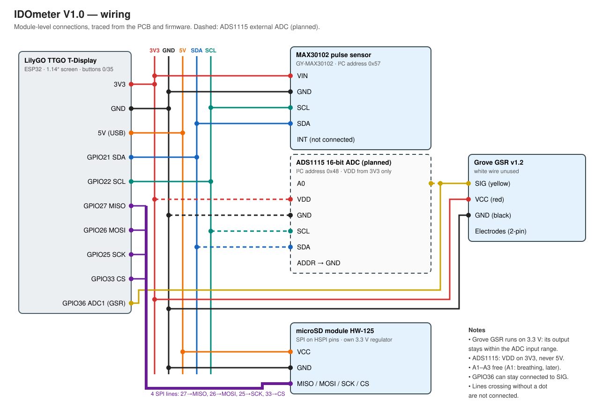

# Hardware — IDOmeter V1.0

Module-level wiring of the V1.0 prototype board (single-sided, home-etched),
traced from the PCB and the firmware. The ADS1115 is a planned addition (dashed).

## Connections

| Module | Pin | T-Display pin | Net |
|---|---|---|---|
| MAX30102 (GY-MAX30102) | VIN | 3V | 3.3 V |
| | GND | G | GND |
| | SCL | GPIO22 | I²C |
| | SDA | GPIO21 | I²C |
| | INT | — | not connected |
| Grove GSR v1.2 (cable soldered to PCB, white wire unused) | VCC (red) | 3V | 3.3 V |
| | GND (black) | G | GND |
| | SIG (yellow) | GPIO36 (ADC1) | GSR signal |
| microSD HW-125 | VCC | 5V | 5 V (module has its own 3.3 V regulator) |
| | GND | G | GND |
| | MISO / MOSI / SCK / CS | GPIO27 / 26 / 25 / 33 | HSPI |
| On-board | buttons | GPIO0, GPIO35 | right button: screen / Wi-Fi setup |

On the PCB, the long trace along the board edge carries 3.3 V from the Grove
pads to the MAX30102 header; the Y-shaped trace is the common ground shared by
the SD module, the MAX30102 header, the Grove sensor and the T-Display.

## Adding the ADS1115 (planned)

| ADS1115 pin | Connect to |
|---|---|
| VDD | 3V (**never 5V**) |
| GND | G |
| SCL | GPIO22 (in parallel with MAX30102) |
| SDA | GPIO21 (in parallel with MAX30102) |
| ADDR | GND → I²C address 0x48 (MAX30102 is 0x57, no conflict) |
| A0 | Grove SIG (yellow); the wire to GPIO36 may stay |
| A1–A3, ALERT/RDY | not connected (A1 reserved for a breathing sensor) |

Before the first power-up with the ADS1115, measure the voltage between the
Grove red and black wires: it must be 3.3 V. With the Grove sensor on 3.3 V its
output cannot exceed the ADS1115 input range.

`wiring.svg` is generated; edit the generator in `tools/make_wiring.py`.
