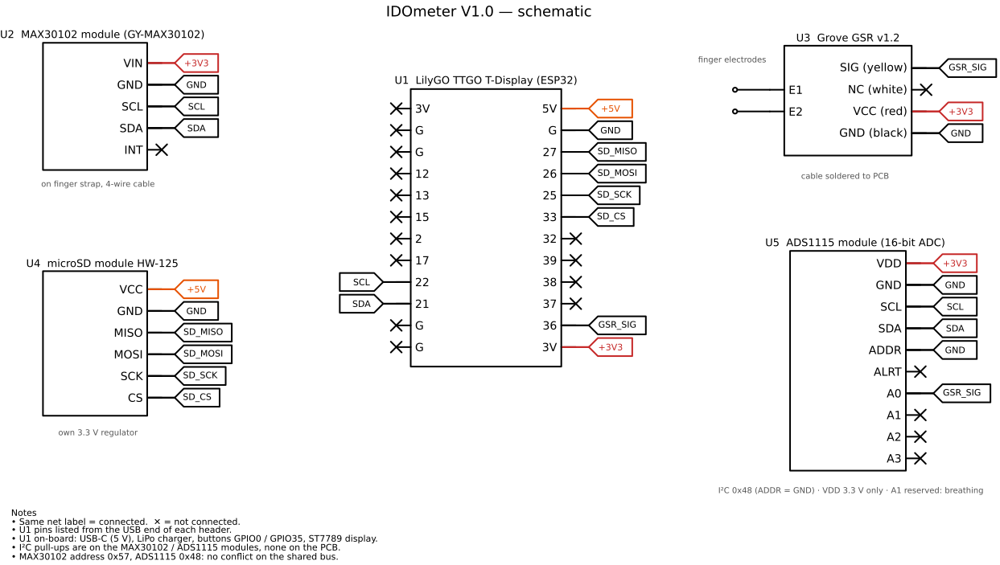
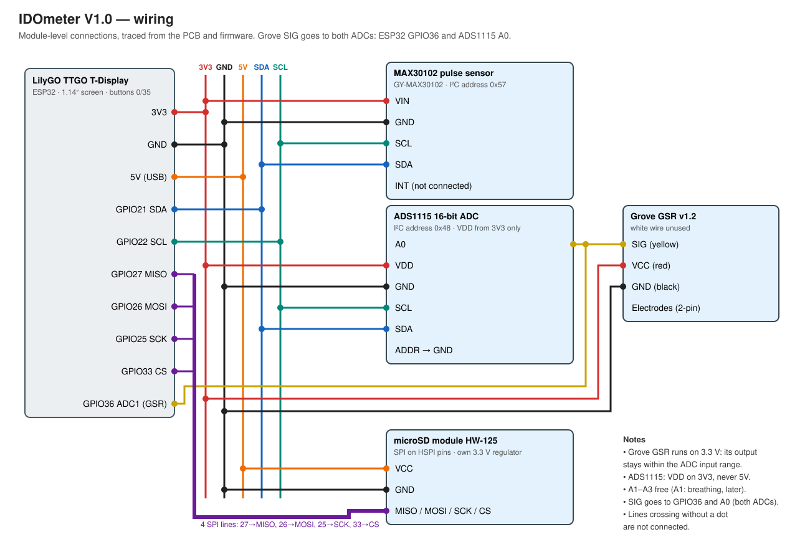
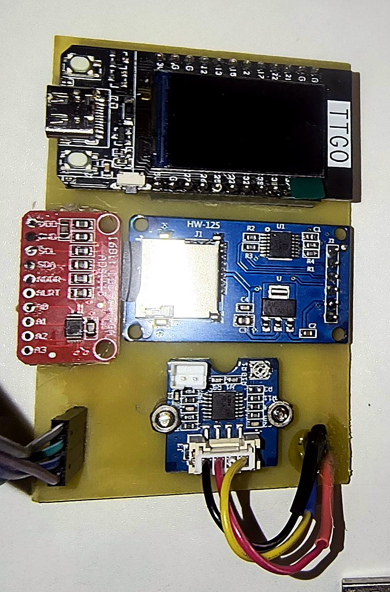
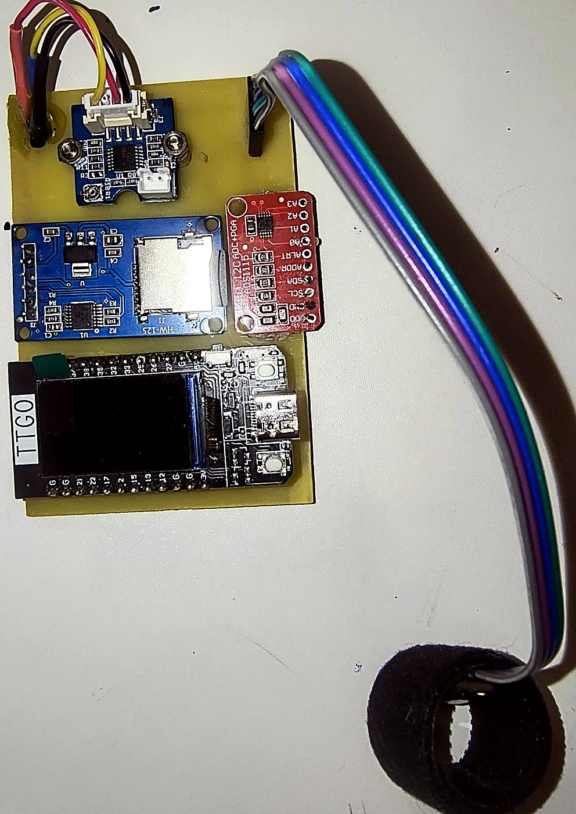
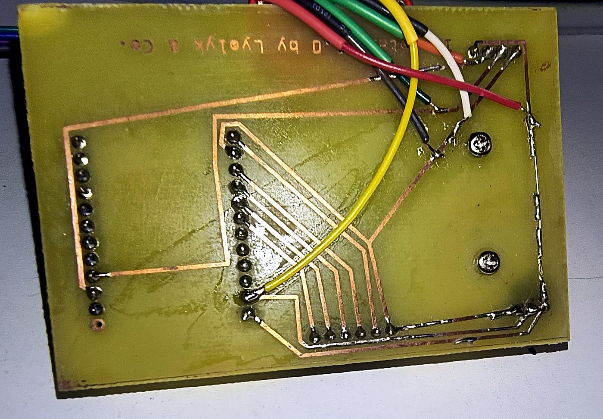

# Hardware — IDOmeter V1.0

## Schematic

Schematic of the V1.0 prototype board (single-sided, home-etched), traced from
the PCB and the firmware. Same net label = connected. The ADS1115 (grey) is a
planned addition, not yet fitted.

## Wiring overview

The same connections drawn as power and bus rails; dashed = ADS1115 (planned).

## Connections

| Module | Pin | T-Display pin | Net |
|---|---|---|---|
| MAX30102 (GY-MAX30102) | VIN | 3V | 3.3 V |
| | GND | G | GND |
| | SCL | GPIO22 | I²C |
| | SDA | GPIO21 | I²C |
| | INT | — | not connected |
| Grove GSR v1.2 (cable soldered to PCB, white wire unused) | VCC (red) | 3V | 3.3 V |
| | GND (black) | G | GND |
| | SIG (yellow) | GPIO36 (ADC1) | GSR signal |
| microSD HW-125 | VCC | 5V | 5 V (module has its own 3.3 V regulator) |
| | GND | G | GND |
| | MISO / MOSI / SCK / CS | GPIO27 / 26 / 25 / 33 | HSPI |
| On-board | buttons | GPIO0, GPIO35 | right button: screen / Wi-Fi setup |

On the PCB, the long trace along the board edge carries 3.3 V from the Grove
pads to the MAX30102 header; the Y-shaped trace is the common ground shared by
the SD module, the MAX30102 header, the Grove sensor and the T-Display.

## ADS1115 (fitted November 2026)

| ADS1115 pin | Connect to |
|---|---|
| VDD | 3V (**never 5V**) |
| GND | G |
| SCL | GPIO22 (in parallel with MAX30102) |
| SDA | GPIO21 (in parallel with MAX30102) |
| ADDR | GND → I²C address 0x48 (MAX30102 is 0x57, no conflict) |
| A0 | Grove SIG (yellow); the wire to GPIO36 may stay |
| A1–A3, ALERT/RDY | not connected (A1 reserved for a breathing sensor) |

Before the first power-up with the ADS1115, measure the voltage between the
Grove red and black wires: it must be 3.3 V. With the Grove sensor on 3.3 V its
output cannot exceed the ADS1115 input range.

Tried and reverted: powering the Grove sensor from 5 V (with a 10k/20k divider
on SIG) to widen its range. The module's trimmer was damaged in the process; the
sensor stays on 3.3 V without a divider. With open electrodes its output is about
2.3 V; ESP32 and ADS1115 read it within 2–3 % of each other.

## Photos

Example build of the V1.0 board with the ADS1115 fitted (November 2026).

Component side: T-Display (top), ADS1115 (red, left), microSD module, Grove GSR
sensor with its cable soldered to the board, pulse-sensor connector (bottom left).

The same board with the MAX30102 pulse sensor in its finger strap.

Copper side (home-etched, single-sided): the ADS1115 and the Grove cable are
wired point-to-point on this side.

The schematic and wiring drawings above still show the ADS1115 as planned;
they will be updated.

Both drawings are generated: `tools/make_schematic.py` (needs `schemdraw`)
and `tools/make_wiring.py`.
